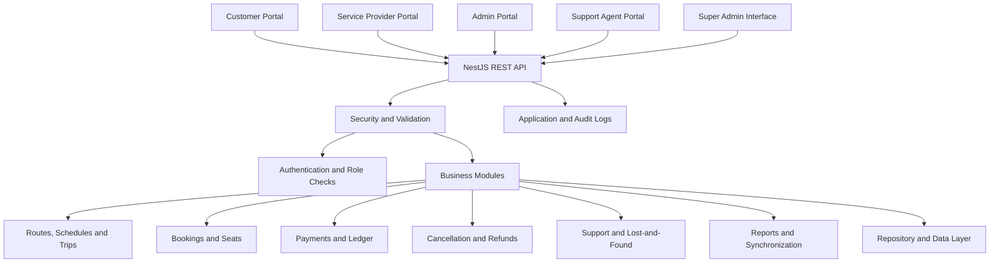

# 🚌 Click2Book — Online Ticket Reservation Platform

Click2Book is a full-stack ticket reservation and transit management platform designed to support travel booking, schedule management, payment processing, cancellations, refunds, customer support, and administrative operations.

The project combines a **NestJS REST API backend** with modern **React/Vite applications** and legacy HTML, CSS, and JavaScript portals. It provides separate workspaces for customers, service providers, administrators, and customer support agents, along with a dedicated Super Admin interface.

## 📑 Table of Contents

- [Overview](#-overview)
- [Key Features](#-key-features)
- [Application Portals](#-application-portals)
- [Super Admin](#-super-admin)
- [Booking Workflow](#-booking-workflow)
- [Technology Stack](#-technology-stack)
- [System Architecture](#-system-architecture)
- [Project Structure](#-project-structure)
- [Backend Modules](#-backend-modules)
- [Security and Logging](#-security-and-logging)
- [Prerequisites](#-prerequisites)
- [Installation and Setup](#-installation-and-setup)
- [Running the Applications](#-running-the-applications)
- [API Documentation](#-api-documentation)
- [Data Management](#-data-management)
- [Current Limitations and Future Improvements](#-current-limitations-and-future-improvements)
- [Contributing](#-contributing)

## 📌 Overview

Click2Book brings the major operations of an online transportation reservation system into one platform.

The system supports:

- Searching for available trips and schedules.
- Viewing routes, departure and arrival information, fares, and seat availability.
- Selecting seats and creating bookings.
- Processing simulated payments and maintaining payment status.
- Managing cancellations and calculating refunds according to configured policies.
- Managing vehicles, routes, schedules, and trips.
- Monitoring operational and financial information.
- Handling customer support requests and ticket lifecycles.
- Maintaining application logs and administrative audit information.

The project uses a modular backend architecture to organize its business logic into separate functional modules.

## ✨ Key Features

### Customer Features

- Search trips by origin, destination, and travel requirements.
- View trip schedules and available seats.
- Select seats using an interactive seat layout.
- Create bookings and proceed through checkout.
- Review payment details and booking status.
- View and manage bookings.
- Cancel eligible bookings and view estimated refund amounts.
- Submit support requests.
- Report lost belongings.
- Manage customer profile information and profile pictures.
- Review trip and service experiences where supported.

### Service Provider Features

- Manage transportation vehicles and fleet information.
- Create and manage routes and schedules.
- Configure departure and arrival information.
- Manage trip availability and seat configurations.
- Monitor bookings and seat occupancy.
- Start or update trip operations.
- View revenue information and platform commission breakdowns.

### Admin Features

- View platform statistics and operational information.
- Monitor routes, trips, and service providers.
- Access administrative management features.
- Review operational reports and financial summaries.
- Support dispute resolution and administrative workflows where implemented.
- Monitor relevant booking and service activity.

### Customer Support Features

- View customer support requests and ticket queues.
- Track support ticket statuses.
- Assist customers with booking-related queries.
- Review refund and cancellation requests.
- Handle support workflows and lost-and-found reports where implemented.

### Platform Capabilities

- Modular REST API architecture.
- Role-based access checks.
- Request validation and centralized exception handling.
- Structured application logging.
- Request correlation IDs for troubleshooting.
- HTTP security headers and API rate limiting.
- File-upload validation for supported profile pictures.
- Shared booking, cancellation, and refund business logic.

## 🖥️ Application Portals

Click2Book provides separate interfaces for the different operational roles.

| Portal | Frontend location | Development URL | Primary purpose |
|---|---|---|---|
| Customer | `front-end/customer/react-app` | `http://localhost:5176` | Trip search, seat selection, booking, payment, cancellations, and profile management |
| Service Provider | `front-end/serviceprovider/react-app` | `http://localhost:5174` | Fleet, routes, schedules, trips, bookings, and revenue |
| Admin | `front-end/admin/react-app` | `http://localhost:5175` | Administrative dashboards, operational oversight, and reports |
| Customer Support Agent | `front-end/supportagent` | `http://localhost:5177` | Support requests, ticket queues, and customer assistance |

The repository also contains legacy static HTML/CSS/JavaScript portals. These can be served separately using the included static portal launcher.

## 🛡️ Super Admin

The project includes a dedicated Super Admin interface under `front-end/super_admin/`.

The audit identifies the following Super Admin capabilities:

- System-wide audit log inspection.
- Service provider verification and blacklisting.
- Master ledger auditing.
- Privileged administrative overrides.

## 🔄 Booking Workflow

The intended booking lifecycle includes the following states:

- **PENDING:** A booking is created and may temporarily hold seats while checkout is in progress.
- **PAID:** Payment has been processed and recorded.
- **CONFIRMED:** The booking is confirmed and the ticket reference is generated.
- **CANCELLED:** The booking is cancelled and the cancellation workflow is initiated.

A typical customer workflow is:

1. Open the Customer portal.
2. Search for a trip.
3. Select a suitable trip and available seats.
4. Enter the required passenger and booking details.
5. Proceed to payment.
6. Complete the simulated payment process.
7. View the resulting booking status.
8. Cancel an eligible booking if necessary and review the calculated refund.

Actual state transitions and seat-release behavior are controlled by the backend business rules.

## 🧰 Technology Stack

| Component | Technologies | Purpose |
|---|---|---|
| Frontend framework | React | Interactive application interfaces |
| Frontend tooling | Vite | Development server and frontend build tooling |
| Frontend languages | JavaScript, HTML5, CSS3 | UI implementation and styling |
| Backend framework | NestJS | Modular REST API development |
| Backend language | TypeScript | Type-safe application logic |
| HTTP platform | Express | HTTP request handling |
| API communication | REST APIs | Communication between frontends and backend |
| API documentation | Swagger / OpenAPI | Interactive API documentation |
| Validation | `class-validator`, NestJS `ValidationPipe` | Request payload validation |
| Security | Helmet, `@nestjs/throttler` | HTTP security headers and rate limiting |
| Logging | Winston, Winston Daily Rotate File | Structured logging and log rotation |
| File uploads | Multer | Multipart upload handling |
| Data layer | Repository stores, TypeScript entities, DTOs, and Mongoose schemas | Data access and data modelling |
| Development runtime | Node.js and npm | Running the backend and frontend tooling |

**Note:** The presence of schemas or data models does not necessarily mean all application data is persisted in a database. The audit identifies in-memory repositories in several modules.

## 🏗️ System Architecture

Click2Book uses separate frontend portals that communicate with a shared backend through HTTP/REST APIs.



### Architecture Highlights

- **Separation of concerns:** Business functionality is organized into dedicated backend modules.
- **Shared API:** Multiple portals use the backend for common business operations.
- **Validation:** DTOs and request validation help enforce expected payload formats.
- **Centralized logging:** Request and application events can be recorded for troubleshooting.
- **Hybrid frontend:** React/Vite applications coexist with legacy static portals.

## 📂 Project Structure

The following is a high-level view of the repository. Some folders contain additional files and nested modules.

```text
13_Click2Book/
│
├── back-end/
│   ├── src/
│   │   ├── common/
│   │   ├── modules/
│   │   │   ├── auth/
│   │   │   ├── customer/
│   │   │   ├── provider/
│   │   │   ├── admin/
│   │   │   ├── route/
│   │   │   ├── vehicle/
│   │   │   ├── seat/
│   │   │   ├── schedule/
│   │   │   ├── trip/
│   │   │   ├── booking/
│   │   │   ├── payment/
│   │   │   ├── cancellation/
│   │   │   ├── refund/
│   │   │   ├── offer/
│   │   │   ├── revenue-split/
│   │   │   ├── payouts/
│   │   │   ├── ledger/
│   │   │   ├── support-request/
│   │   │   ├── support-ticket/
│   │   │   ├── lost-found/
│   │   │   ├── emergency/
│   │   │   ├── tracking/
│   │   │   ├── review/
│   │   │   ├── report/
│   │   │   └── sync/
│   │   ├── seed/
│   │   ├── app.module.ts
│   │   └── main.ts
│   └── package.json
│
├── front-end/
│   ├── customer/
│   │   ├── react-app/
│   │   └── *.html
│   ├── serviceprovider/
│   │   ├── react-app/
│   │   └── *.html
│   ├── admin/
│   │   ├── react-app/
│   │   └── *.html
│   ├── supportagent/
│   └── super_admin/
│
├── Database/
├── reports/
├── tools/
│   └── start-portals.js
├── definitions.yml
├── SRS.pdf
└── README.md
```

The folder names above summarize the audit. Refer to the actual repository for the complete and current directory structure.

## ⚙️ Backend Modules

The audit identifies 26 feature modules grouped by their responsibilities.

### Authentication and User Management

| Module | Responsibility |
|---|---|
| `auth` | Authentication and token issuance |
| `customer` | Customer profiles and profile picture uploads |
| `provider` | Service provider registration and management |
| `admin` | Administrative capabilities and dashboard information |
| `support` | Support staff information and assignment |

### Travel and Fleet Management

| Module | Responsibility |
|---|---|
| `route` | Origin-destination routes, stops, distances, and base fares |
| `vehicle` | Vehicle inventory and transport details |
| `seat` | Seat layouts and seat reservation logic |
| `schedule` | Departure and arrival schedules |
| `trip` | Trip instances associated with routes, vehicles, and schedules |

### Booking and Transactions

| Module | Responsibility |
|---|---|
| `booking` | Booking creation and booking lifecycle management |
| `payment` | Payment processing and transaction status |
| `cancellation` | Booking cancellation workflows |
| `refund` | Policy-based refund calculations |
| `offer` | Coupon discounts and promotional offers |

### Financial Management

| Module | Responsibility |
|---|---|
| `revenue-split` | Provider payout and platform commission calculations |
| `payouts` | Payout and transfer records |
| `ledger` | Financial transaction records and auditing |

### Support and Safety

| Module | Responsibility |
|---|---|
| `support-request` | Customer support requests |
| `support-ticket` | Support ticket queues and status management |
| `lost-found` | Lost belongings reporting and recovery workflows |
| `emergency` | Emergency alerts and related operational workflows |
| `tracking` | Bus tracking and location information |
| `review` | Customer ratings and service feedback |

### Analytics and Synchronization

| Module | Responsibility |
|---|---|
| `report` | Operational and financial reporting |
| `sync` | Cross-portal state synchronization |

The audit also identifies common logging, security, middleware, and exception-handling infrastructure. Actual endpoint availability and implementation details should be verified against the corresponding source files.

## 🔐 Security and Logging

The audit reports the following security and observability mechanisms in the backend.

### HTTP Security Headers

Helmet is used to configure HTTP security headers, including protections related to MIME sniffing, clickjacking, and referrer information.

### Request Validation

NestJS `ValidationPipe` and DTO validation help validate incoming requests and reject invalid payloads according to configured rules.

### Rate Limiting

The audit reports a global throttling policy of **100 requests per 60-second window per IP address**. The effective behavior depends on the current backend configuration.

### Request Correlation

Request ID middleware generates a request identifier and makes it available through request context and response headers. This helps correlate API requests with logs.

### Structured Logging

Winston is used for application logging, with separate log categories reported for application events, administrative activity, and errors. The audit describes daily log rotation, retention, compression, and sensitive-field redaction.

### File Upload Validation

The audited customer profile-picture endpoint supports validation of image MIME types and file sizes, with safe filename generation and path traversal safeguards.

### Important Security Consideration

The audit notes that role checks currently rely on a custom `x-role` request header for development and testing. Client-supplied role headers can be spoofed, so this mechanism should not be treated as sufficient production authorization. Production deployment should use authenticated identities and trusted server-side role enforcement.

The audit also identifies permissive CORS configuration as an area for production hardening.

## 📋 Prerequisites

Install the following before starting the applications:

- Node.js version compatible with the backend and frontend packages. The audit specifies Node.js 18 or later for the backend.
- npm.
- Git, if cloning the repository.
- A terminal such as PowerShell, Command Prompt, or a Unix shell.

Check your installed versions:

```bash
node --version
npm --version
git --version
```

## 🚀 Installation and Setup

### 1. Clone the repository

```bash
git clone https://github.com/IIIT-Sricity-FSD-2024-2028/13_Click2Book.git
cd 13_Click2Book
```

### 2. Install backend dependencies

```bash
cd back-end
npm install
```

### 3. Configure environment variables

Check the backend configuration and existing environment example files before adding variables. If the application requires environment variables, configure them according to the actual code.

Typical settings may include:

```env
PORT=3000
JWT_SECRET=replace_with_a_secure_secret
```

Add a database connection variable only if the current application configuration requires it. Do not commit real credentials, private keys, or production secrets.

### 4. Start the backend

From the `back-end` directory, run:

```bash
npm run start:dev
```

This command assumes the `start:dev` script exists in `back-end/package.json`. If it does not, use the development command defined by the project.

The audited backend API is configured for port `3000`.

## ▶️ Running the Applications

Run the backend and each frontend in separate terminal windows so they can operate concurrently.

### Backend API

```bash
cd back-end
npm install
npm run start:dev
```

### Customer Portal

```bash
cd front-end/customer/react-app
npm install
npm run dev
```

Expected development URL: `http://localhost:5176`

### Service Provider Portal

```bash
cd front-end/serviceprovider/react-app
npm install
npm run dev
```

Expected development URL: `http://localhost:5174`

### Admin Portal

```bash
cd front-end/admin/react-app
npm install
npm run dev
```

Expected development URL: `http://localhost:5175`

### Customer Support Agent Portal

```bash
cd front-end/supportagent
npm install
npm run dev
```

Expected development URL: `http://localhost:5177`

### Super Admin Interface

Open a separate terminal from the repository root and run:

```bash
cd front-end/super_admin/front-end
npm install
npm run dev
```

Expected development URL: `http://localhost:5178`

### Launch the Legacy Static Portals

The repository includes a static portal launcher:

```bash
node tools/start-portals.js
```

Run this command from the repository root. According to the audit, the static portals use ports in the `3001`–`3005` range. Check the launcher configuration for the exact mapping.

**Important:** The listed URLs and commands reflect the audit's reported configuration. If a port or npm script differs in your current checkout, follow the relevant `package.json`, Vite configuration, and launcher configuration.

## 📖 API Documentation

The backend uses Swagger/OpenAPI for API documentation.

If Swagger is enabled at the audited route, open:

`http://localhost:3000/api/docs`

Use the documentation to inspect available endpoints, request formats, response structures, and validation requirements.

The exact set of available endpoints depends on the controllers currently registered in the backend.

## 🗄️ Data Management

The audit identifies a hybrid data layer involving repository stores, TypeScript entities, DTOs, and Mongoose schemas.

Several modules currently use in-memory data structures and seeded data. This means:

- Some records may reset when the backend restarts.
- In-memory data should not be assumed to persist across application restarts.
- The existence of a schema does not establish that the corresponding data is persisted in a connected database.
- Frontend state and local storage should not be treated as the authoritative source for server-side booking, payment, or cancellation status.

Persistent database integration should be verified module by module before describing the entire platform as database-backed.

## 🚧 Current Limitations and Future Improvements

The audit identifies the following areas for further development and production readiness:

1. **Database persistence:** Replace in-memory repository storage where necessary with persistent database-backed implementations and appropriate transaction handling.
2. **Authentication and authorization:** Strengthen server-side role enforcement and rely on trusted authenticated identities rather than client-supplied role headers.
3. **CORS configuration:** Restrict allowed origins to the required frontend domains in production.
4. **Frontend consolidation:** Reduce maintenance overhead by consolidating legacy static portals after their required functionality has been migrated and validated.
5. **Transaction reliability:** Strengthen transaction consistency for concurrent bookings, seat allocation, payments, cancellations, and refunds.
6. **Deployment readiness:** Configure production secrets, secure deployment settings, persistent storage, monitoring, and operational backups.

These are audit-identified improvement areas, not claims that the features are already complete.

## 🤝 Contributing

Contributions should preserve the existing architecture and avoid unrelated changes.

1. Review the relevant frontend and backend modules before editing.
2. Keep changes scoped to the feature or bug being addressed.
3. Follow the existing naming conventions and module structure.
4. Do not commit credentials, tokens, or private environment files.
5. Test the affected workflow and its related error cases.
6. Update documentation when behavior, configuration, or setup instructions change.

For frontend changes, preserve the existing page styling and behavior unless a redesign is explicitly required.

---

**Click2Book** — An integrated platform for online ticket reservations, transportation operations, and customer support.